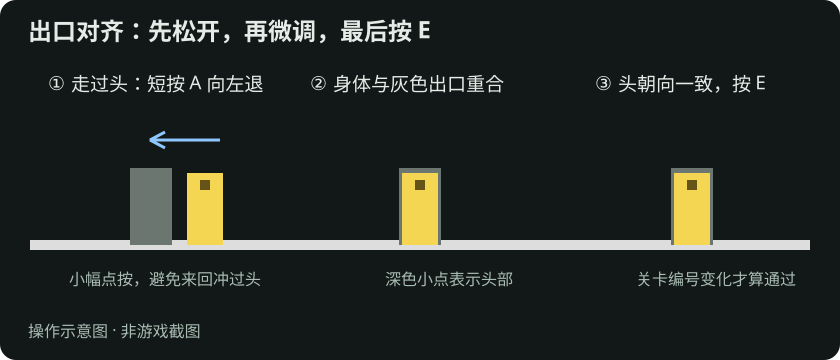
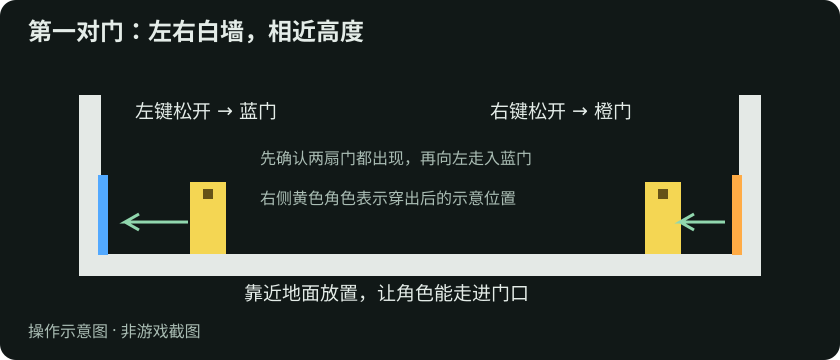
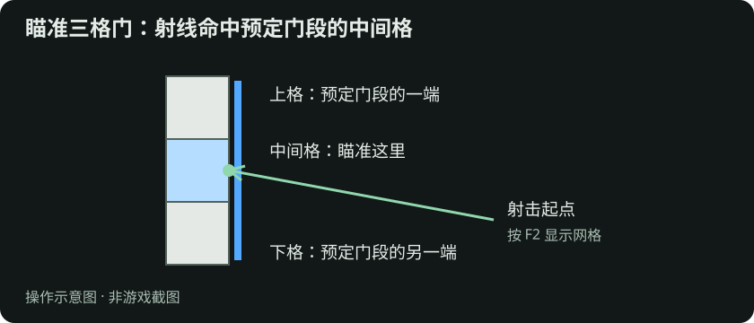

# Por2D · 三分钟上手

以下以第一章、本机游玩、默认键位为例。

**目标：** 控制黄色角色，利用蓝、橙两扇传送门，走到灰色出口，让身体与出口重合、头朝向一致，然后按 **E** 过关。

只需要记住这几个键：

| 按键 | 作用 |
| --- | --- |
| A / D | 向屏幕左 / 右移动 |
| W | 跳跃 |
| 鼠标左键 / 右键 | 放蓝门 / 橙门（**松开时**发射） |
| E | 交互 / 进入出口 |
| Esc | 菜单 / 暂停 |

## 第 1 步：走到出口（Level 0）

从菜单选择 **第一章 → Level 0「概念」**。

1. 按住 **D** 向右走，快到灰色出口时**松开**。
2. 角色会继续滑行一小段。等它慢下来，用**短按** A 或 D 微调，让黄色身体盖住灰色出口。
3. 保持头朝上，按 **E**。

看到关卡编号变化，才算过关。碰到出口边缘不算。

**小提示：** 不要一直按着方向键冲向出口。先松开，再点按，这是这个游戏最基本的操作习惯。

## 第 2 步：放第一对传送门

回到 Level 0（按 Esc 重新选关），试试传送门：

1. 鼠标指向**左侧白墙**靠近地面的位置，按下并**松开**左键，出现蓝门。
2. 鼠标指向**右侧白墙**相近的高度，松开右键，出现橙门。
3. 走进其中一扇门，你会从另一扇门出来。

蓝、橙两扇门都放好才能传送；只放一扇时，走进去没有反应。

### 放不上去？看预览

鼠标移动时，画面上会显示预览（按 **Q** 开关）：

| 你看到的 | 意思 |
| --- | --- |
| 蓝、橙两支箭头 | 两种门都能放 |
| 只有一种颜色的箭头 | 只能放那种颜色，用对应的鼠标键 |
| 红色叉号 | 这里放不了 |

放不上去的常见原因：

- **墙是深灰色。** 只有白色墙面能放门。
- **没有命中中间格。** 一扇门占三格墙，射线必须打在**正中间那一格**上。按 **F2** 显示网格，瞄准目标墙段的正中间。
- **门前面没有足够空间**，或者射线被障碍挡住了。

## 第 3 步：穿门之后

- 从门里出来后，身体可能变成横着或倒立。**A / D / W 仍然是屏幕方向**，不会跟着身体转。
- 门的箭头表示门的朝向，不是你前进的方向。放门前先看箭头，能预判出来后头朝哪边。
- 出口要求头朝向也一致。如果出来的姿态不对，退回空地，换个位置或角度重新放门。

## 卡住了怎么办

| 情况 | 做法 |
| --- | --- |
| 想重来 | 按 **R**（没有检查点就重开本关） |
| 想保存进度 | 正常速度下，身体完全在门外站稳约 1 秒后按 **C**；调慢速度后需等待更久 |
| 需要慢慢想 | 按 **Esc** 暂停；也可在设置中调慢速度。 |
| 站在出口却过不了 | 微调位置，确认头朝向一致，再按 **E** |
| 突然回到检查点或起点 | 身体碰到地图边界会恢复检查点（未保存则回起点），画面边缘不是地面 |
| 实在解不开 | 按 Esc 换一关，回头再来 |

## 下一步

1. 菜单 → **玩法指南 → 入门与进阶练习（九段演示）**：第 2–6 段可以亲自试试，不影响正式进度。
2. 继续闯第一章后面的关卡。
3. 想了解锁门、换门、双人合作等规则，看完整教程：页面上方的“完整教程”链接（`/tutorial-full.html`）。
